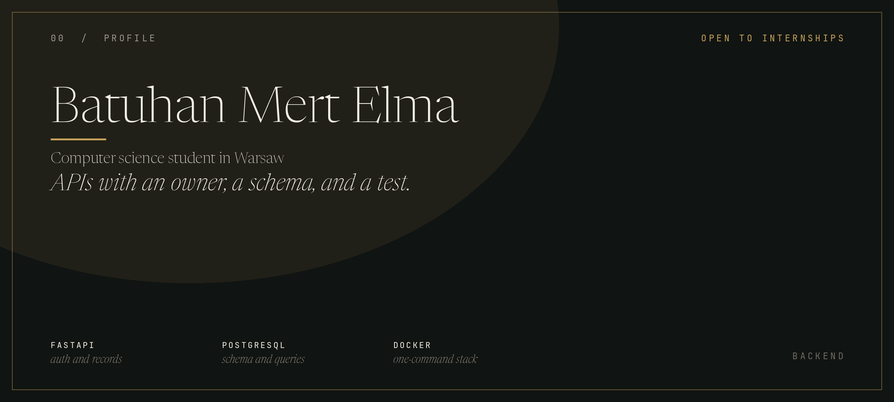

  

Computer science student in Warsaw. I build backend services in Python: sign-in, records that belong to one person, and tests that keep that boundary intact.

Open to internships and junior backend roles.

[LinkedIn](https://www.linkedin.com/in/batuhan-mert-elma-60a9a9363) · [Email](mailto:batuhanmertelma20@gmail.com) · [GitHub](https://github.com/mertbatuhan0)

## Selected work

### 01 · Expense Tracker

REST API for personal expenses. A person registers, receives a short-lived JWT, and manages only their own records. Listing supports title search, an amount range, and pagination.

PostgreSQL 16, SQLAlchemy, Alembic, Docker Compose, and pytest for the auth and expense paths.

[Repository](https://github.com/mertbatuhan0/Expense-Tracker)

### 02 · Northline Desk

A dispatch board for a city that fits on one screen. Incidents, weather, blocked streets, and the station clock enter a local priority queue. Six handlers assign units, raise calls that wait, move crews, and write the radio log.

The queue stays on the machine: in the browser tab, and in one Node process. Next.js on the surface, the same engine underneath.

[Repository](https://github.com/mertbatuhan0/northline-desk-)

### 03 · Master Shop

A retail simulation in Python. A `Product` base, an `Electronic` subclass, and associations between shop, catalog, and customer. Cart and checkout sit on the objects.

[Repository](https://github.com/mertbatuhan0/master-shop-system)

## Working rules

- A record has an owner, and every query respects that.
- The project starts with one command.
- A broken rule should fail a test.

## Stack

| | |
| --- | --- |
| Language | Python, TypeScript |
| Services | FastAPI, Pydantic, Uvicorn |
| Data | PostgreSQL, SQLAlchemy, Alembic, SQL |
| Assurance | pytest, JWT, bcrypt |
| Delivery | Docker, Git |
| Interface | Next.js, React |

## Also on GitHub

Smaller studies in the same direction: a [library model](https://github.com/mertbatuhan0/library-management), a [to-do list](https://github.com/mertbatuhan0/ToDo-App) with explicit error handling, a [PokéAPI client](https://github.com/mertbatuhan0/pokemon-client), and a [book factory](https://github.com/mertbatuhan0/book-factory).

---

Warsaw, Poland
